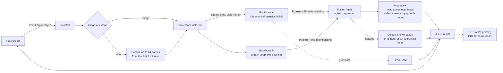

# Architecture

DeepShield is a single FastAPI service that serves both the API and the web UI.
Everything runs on CPU, so it fits on the free Hugging Face Spaces tier.

## Request lifecycle

1. **Validation** (`app/api/routes.py`): file type by MIME type or extension, size
   limits (10 MB images, 60 MB videos), empty and corrupt files rejected with clear
   4xx messages.
2. **Face detection** (`app/services/face_detector.py`): OpenCV YuNet, a 230 KB CNN.
   Falls back to a Haar cascade if the weights cannot be fetched. Each face is
   cropped as a square with 25% extra context, because blending artifacts usually
   sit at the boundary between the swapped face and the original head.
3. **Scoring** (`app/services/classifier.py`): every crop goes through two
   pretrained vision transformers. A forward pre-hook on each classification head
   captures the pooled embedding, so the same code works for ViT and SigLIP models.
4. **Fusion**: a logistic-regression head trained on our data takes
   `[embedding_A, embedding_B, logit_A, logit_B]` (384 + 768 + 2 = 1,154 features, standardized)
   and outputs the final probability. If the head file is missing, the service
   falls back to averaging the two backbones and reports `engine: ensemble-mean`.
5. **Aggregation** (`app/services/analyzer.py`):
   * Image: the highest face score, since one manipulated face is enough.
   * Video: `0.5 * mean + 0.5 * mean(top 25%)` across frames. Pure averaging
     dilutes clips where only part of the video is manipulated; pure max is noisy.
6. **Verdict bands**: fake at 0.6 or above, real at 0.4 or below, otherwise
   *inconclusive*. Showing "inconclusive" honestly is better than a coin-flip label.
7. **Explanation**: Grad-CAM on the last transformer block of backbone A, using
   the gradient of the fake-minus-real logit, overlaid on the crop.
8. **Closest known cases** (`app/services/similar.py`): the fusion features are
   standardized, weighted by the absolute fusion coefficients (so the dimensions that
   matter for the decision dominate), projected to 64 dimensions with PCA and
   L2-normalized. Cosine similarity against the 3,440 training faces returns the 5
   nearest, with their label and kind of fake. Built offline by
   `ml/scripts/build_similar_index.py`; the 686 KB index holds numbers and labels
   only. It is evidence for the user, not an input to the score. One exception: if
   the closest case is below the unfamiliar threshold stored in the index (0.576, the
   2nd percentile of leave-group-out similarities between training faces), the face
   is outside what the model learned and the verdict becomes "inconclusive".
9. **Report**: results are kept in a 64-entry in-memory LRU so the PDF can be
   generated on demand. Uploaded files are never written to permanent storage
   (videos touch a temp file that is deleted immediately after decoding).

## Code map

| Path | Responsibility |
|---|---|
| `app/main.py` | App factory, static UI, background model warm-up |
| `app/api/routes.py` | `/api/health`, `/api/analyze`, `/api/report/{id}`, `/api/metrics` |
| `app/api/deps.py` | Lazily built analyzer singleton, result cache |
| `app/services/face_detector.py` | YuNet / Haar detection and cropping |
| `app/services/classifier.py` | Backbones, fusion head, Grad-CAM, test stub |
| `app/services/analyzer.py` | Image and video pipelines, verdict logic |
| `app/services/similar.py` | Closest-known-cases retrieval over the training faces |
| `app/services/report.py` | ReportLab PDF |
| `app/static/` | Vanilla HTML/CSS/JS UI with a self-hosted font, no build step |
| `ml/scripts/prepare_data.py` | Builds the face-crop dataset from 4 public sources |
| `ml/scripts/train_fusion.py` | Benchmarks backbones, model selection, trains the head |
| `ml/scripts/eval_videos.py` | End-to-end evaluation on whole held-out videos |
| `ml/scripts/build_similar_index.py` | Builds the closest-known-cases index and reports its kNN accuracy |
| `ml/scripts/make_figures.py` | ROC, per-dataset and confusion-matrix charts |
| `tests/` | API and unit tests (stub models, no downloads) |

## Design decisions

* **Why fine-tune a head instead of the whole network?** We had no GPU budget.
  Freezing the backbones and training a linear head on their embeddings takes
  seconds once features are cached, cannot overfit as easily on a few thousand
  samples, and still lets the system learn which backbone to trust for which
  kind of fake. The training notebook shows how to unfreeze for a full fine-tune
  on a free Kaggle GPU.
* **Why two backbones?** Different public detectors were trained on different
  families of fakes, and they fail differently. Model selection on a validation
  split (never the test split) picked the pair whose combination generalizes best.
* **Why the same detector at train and inference time?** The dataset builder
  calls the exact cropping code the API uses, so the head never sees a
  distribution it was not trained on.
* **Why no frontend framework?** One HTML file, one CSS file, one JS file. No
  build step, nothing to break during a live demo, and it loads instantly.
